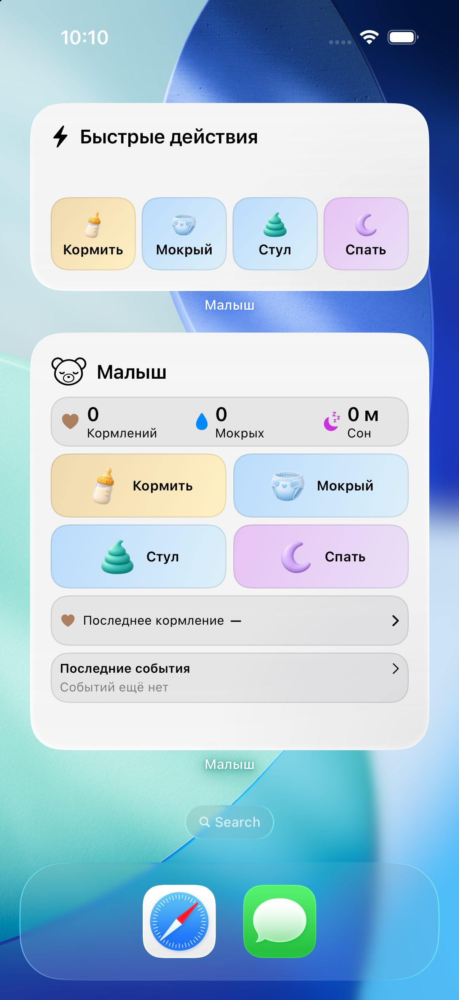
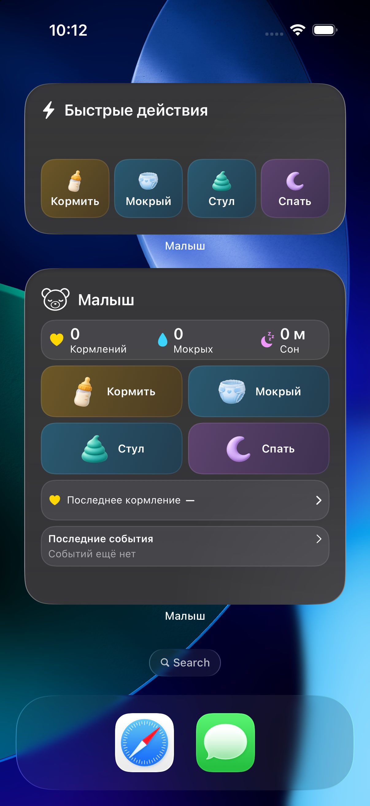
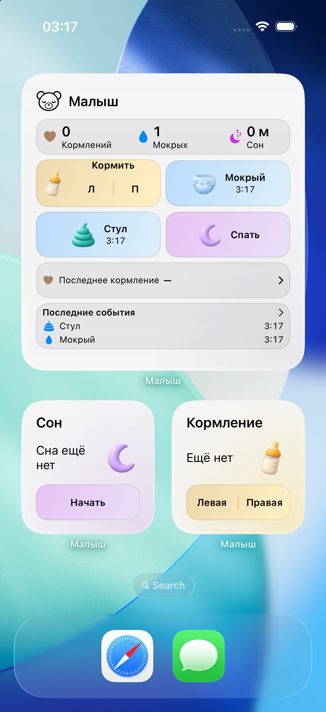
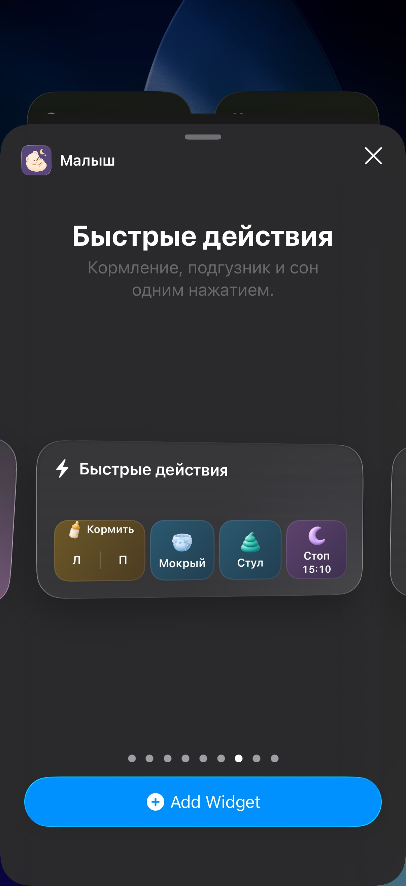
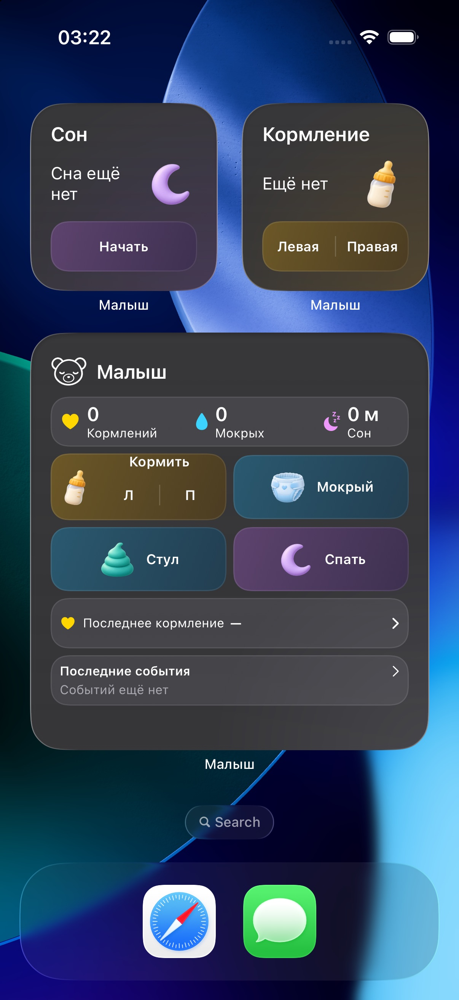

# Проверка редизайна домашних виджетов

6 ноября 2026. Small, Medium и Large проверены в настоящем WidgetKit на **iPhone 17 Pro, iOS Simulator 26.0.1 (23A8464)**, Xcode 27.2. Виджеты устанавливались через системный каталог, команды выполнялись на Home Screen через XCTest. Снимки ниже — фактические экраны Simulator, не рендеры SwiftUI в отдельном приложении.

Ветка `nnafranets/feature/widget-visual-redesign` перебазирована на `main` (`96c01b2`). Использована новая векторная `BabyBear`. Последний подтянутый коммит меняет только workflow и документацию TestFlight; код приложения и результаты проверки от него не меняются.

## Упрощение кормления в Medium и Large

По уточнённому запросу в Medium и Large убраны «Л/П» и внутренний разделитель. Вместо них используется цельная плитка «Кормить» с такой же компоновкой и шириной, как у соседних действий. Она открывает существующий выбор кормления в приложении через `WidgetRoute(.breast, babyID:)`; запись создаётся только после выбора пользователя. В Small остаются две кнопки сторон. Активные таймеры и завершение не менялись.

Обновлённые Medium и Large на одном Home Screen: [светлая тема](WidgetScreenshots/feed-tile-light.jpg), [тёмная тема](WidgetScreenshots/feed-tile-dark.jpg), [максимальный Dynamic Type](WidgetScreenshots/feed-tile-accessibility.jpg). Обрезки текста и выхода изменённой плитки за границы не обнаружено; размеры и расположение иконки с подписью соответствуют соседним действиям.

После этой правки сборка приложения и расширения прошла, `WidgetRouteTests` (2) и `WidgetSystemUITests` (2) завершились успешно: **4 passed, 0 failed, 0 skipped** (`Artifacts/WidgetRedesign/feed-link-functional.xcresult`). Новых постоянных тестов не добавлено. Проверка рамок в системном accessibility-дереве: обычный Medium — 74,7 × 64 pt, Large — 154 × 56 pt; при максимальном Dynamic Type — 154 × 44 pt в обоих семействах.

Отдельный временный сценарий подтвердил холодный переход из обоих семейств в [настоящий диалог «Кормление»](WidgetScreenshots/feed-tile-chooser.jpg), а после перезапуска без выбора — отсутствие таймеров и записей. Полный цикл выбора стороны этим сценарием не подтверждён: после автоматического нажатия «Левая грудь» диалог оставался в accessibility-дереве, ожидание таймера завершилось ошибкой. В тестовой базе после Medium записи также не было; причина не установлена как ошибка приложения или синтезированного нажатия. Итог этого дополнительного набора — 0/2, а не успешная проверка; результаты сохранены в `Artifacts/WidgetRedesign/feed-link-behavior-final.xcresult`. Перед ним исправлялись селекторы временного сценария; исходники приложения от этих повторов не менялись. Дальнейшие повторы остановлены. Ручное нажатие через Computer Use недоступно: инструмент не распознал Simulator по имени и пути Xcode. SwiftFormat и строгий SwiftLint прошли после восстановления постоянного набора тестов.

## Исходная серия снимков (`9459ce6`)

Ниже сохранена проверка первой версии PR. В этих снимках Medium и Large ещё показывают две стороны кормления; к текущей версии относится упрощение, описанное выше.

Полные экраны сохранены в JPEG без изменения композиции; исходные PNG и результаты находятся локально в `Artifacts/WidgetRedesign`. Галерея WidgetKit использует демонстрационные данные провайдера; установленные виджеты — отдельный тестовый дневник, изменяемый настоящими App Intents.

| Сценарий | Фактические снимки |
| --- | --- |
| Small кормление: выбор стороны, активный таймер, сохранение | [Базовое состояние](WidgetScreenshots/home-light.jpg), [таймер и смена груди](WidgetScreenshots/feeding-active.jpg), [завершение с сохранённой правой стороной](WidgetScreenshots/feeding-completed.jpg) |
| Small сон | [Базовое состояние](WidgetScreenshots/home-light.jpg), [активный сон](WidgetScreenshots/sleep-active.jpg), [завершённый сон](WidgetScreenshots/sleep-completed.jpg) |
| Small подгузники | [После холодной записи](WidgetScreenshots/diaper-saved.jpg), [тёмная тема](WidgetScreenshots/diaper-dark.jpg) |
| Medium быстрые действия | [Светлая тема](WidgetScreenshots/medium-actions-light.jpg), [тёмная тема](WidgetScreenshots/medium-actions-dark.jpg) |
| Medium сводка | [Светлая тема с активным сном](WidgetScreenshots/medium-summary-light.jpg), [тёмная тема](WidgetScreenshots/medium-summary-dark.jpg) |
| Large: данные, две последние записи | [Home Screen](WidgetScreenshots/home-light.jpg), [тёмная галерея с возрастом и активным сном](WidgetScreenshots/large-dark.jpg) |
| Large без записей | [Тёмный Home Screen](WidgetScreenshots/home-dark.jpg) |
| Системное окрашивание | [Tinted](WidgetScreenshots/tinted.jpg), [Clear](WidgetScreenshots/clear.jpg) — панель настройки закрыта |
| Максимальный Dynamic Type | [Завершённое кормление](WidgetScreenshots/feeding-completed-accessibility.jpg), [завершённый сон](WidgetScreenshots/sleep-completed-accessibility.jpg), [сводка с активным сном](WidgetScreenshots/summary-active-accessibility.jpg) |
| Кормление за предыдущий день | [Дата и время в Small и Medium](WidgetScreenshots/previous-day-accessibility.jpg) |

## Что проверено

- Кормление запускается с явно выбранной стороны; смена стороны и завершение сохраняют ту же запись. После завершения возвращаются обе кнопки запуска, старой кнопки «Стоп» нет.
- Сон проходит цикл запуска и завершения; запись остаётся после перезапуска, Live Activity соответствует той же сессии и завершается вместе с ней.
- Холодные команды мокрого подгузника и стула не открывают приложение, обновляют снимок, время и счётчик. Повторная доставка команды не создаёт дубликаты.
- Large показывает две реальные последние записи с временем; обычные размеры не обрезают текст и действия. Medium меняет соответствующий элемент при активном сне или кормлении.
- При максимальном Dynamic Type приоритет отдан основным данным и действиям. Системное accessibility-дерево подтвердило конечные рамки и доступность кнопок; Small «Стоп» у кормления и сна имеет область 128,3 × 44 pt. Стороны остаются двумя явными действиями.
- Tinted и Clear используют системное окрашивание и прозрачную поверхность. Насыщенные изображения и градиенты доступны только в fullColor.

Доступность для VoiceOver проверена по подписям, значениям и структуре системного accessibility-дерева. Прослушивание озвучки и проверка на физическом устройстве не выполнялись. В установленной сводке при максимальном Dynamic Type системное значение таймера сна изменилось с `0:40` до `0:41`; это проверено отдельно от статического снимка. В записи за предыдущий день Small показывает дату и время, Medium — дату и время в строке кормления; сегодняшние счётчики остаются нулевыми.

## Сборка и тесты

`Scripts/check.sh` завершился успешно: SwiftFormat, строгий SwiftLint, генерация Tuist, сборка приложения и расширения, затем **23 теста — 23 passed, 0 failed, 0 skipped**. Результат: `Artifacts/WidgetRedesign/final-functional.xcresult`.

| Строка матрицы | Набор | Результат |
| --- | --- | --- |
| W | `WidgetSnapshotTests` + `WidgetRouteTests` | 8 passed |
| I | `CareActivityActionTests` | 7 passed |
| L | `CareActivityCoordinatorTests` | 4 passed |
| S | `LiveActivityUITests` + `WidgetSystemUITests` | 4 passed |

Существующий round-trip тест снимка дополнен сохранённой стороной кормления и чтением прежнего JSON без этого поля. Существующий системный тест сна перенесён на Small и проверяет доступность кнопки завершения внутри виджета и её исчезновение после сохранения; второй системный тест сохраняет покрытие Medium. Количество постоянных тестовых методов не увеличено.

Временные сценарии захвата проверили светлый набор (5/5), тёмную галерею и Tinted/Clear (2/2), максимальный Dynamic Type и реальные действия Small (2/2). После последних узких изменений подписей доступности выполнены отдельная сборка и целевые проверки завершённых состояний Small (1/1), динамического значения таймера в Medium (1/1) и записи за предыдущий день (1/1). Последний сценарий потребовал исправления селектора системного календаря и отдельного повторного запуска; первоначальная ошибка произошла до сохранения записи. Эти сценарии не добавлены в постоянный тестовый набор или CI. Доменные проверки без изменений повторно не запускались.

Первичная проверка выявила некорректный intrinsic-размер системного таймера внутри `ViewThatFits`/`fixedSize`, пропадание подписей при ограниченной высоте и переполнения максимального Dynamic Type. В итоговой компоновке таймер не участвует в таком подборе размеров; соответствующие состояния повторно проверены на Home Screen. На первом запуске чистого Simulator каталог ещё не проиндексировал расширение; после регистрации провайдера установка через каталог проверена успешно.

Независимое итоговое ревью Terra 6.1 xhigh сопоставило реализацию и нативные снимки с концептами. Все выявленные замечания к дате старой записи, подписи завершённых состояний и крупному тексту исправлены и повторно проверены; открытых существенных замечаний не осталось. Обычные размеры сняты до последних изменений, затрагивающих только размеры доступности и дату старой записи; эти изменения подтверждены отдельными снимками выше.

## Адаптация концептов

- Горизонтальная композиция Large преобразована в вертикальную панель шириной Medium: шапка, итоги, действия 2×2 и короткая история.
- В Small сохранён осознанный выбор левой или правой груди. По последующему уточнению в Medium и Large единая плитка «Кормить» открывает существующий выбор в приложении.
- Отдельный краткий экран «Сохранено» не имитируется. После сохранения показываются обновлённые данные и базовые действия; секунды таймера отображает система.
- Четыре небольшие иллюстрации весят суммарно **191 157 байт** во всех трёх масштабах. В системных режимах их заменяют читаемые символы. [Ресурсы и точные запросы imagegen](Assets/WidgetArtwork.md).
- Подробные решения и размеры описаны в [WidgetDesign.md](WidgetDesign.md). Основные экраны приложения, Core Data, CloudKit, AppStore, App Intents, оформление Live Activities и Lock Screen не перерабатывались.

Релиз, тег и отправка в TestFlight не выполнялись.
